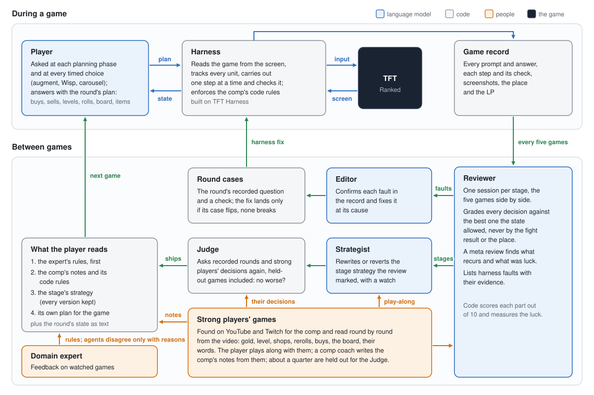

# TFT Climb

A team of language-model agents that plays Teamfight Tactics Ranked and learns from its own games and from strong
players' games. Built on [TFT Harness](https://github.com/fancy1026/tft-harness).

- **Learns from its own games.** After each game a Reviewer grades every decision, a Strategist rewrites the stage
  strategies that went wrong, and an Editor fixes the harness faults the review found.
- **Learns from strong players.** It finds strong players' games of its comp on YouTube and Twitch and reads them
  round by round from the video. The player plays along with them, and every new strategy is tested against their
  decisions.
- **Every change is tested on the game that found it.** A fault becomes a round case: the round's recorded question
  and a check. A fix lands only when its case passes and no other case breaks; a new strategy ships only if a Judge
  in code scores it no lower, on games no agent has read.
- **An expert in the loop.** A domain expert's feedback becomes rules that come first for the player and for every
  agent. An agent may disagree, but only with reasons and evidence, and the rule holds until the expert changes it.

<p align="center">
  
</p>

**Figure 1.** During a game (top), the player model plans each round and the harness carries the plan out. Between
games (bottom), the agents review the record, learn from strong players' games, and change what the player reads and
the harness it plays through.

## How it works

- **The player.** A language model plays every round through
  [TFT Harness](https://github.com/fancy1026/tft-harness), which reads the screen and carries out its plans. It plays
  with what the agents have learned so far: the expert's rules, the comp's notes and a strategy for each stage.
- **Review.** After a game, a Reviewer goes through it stage by stage and judges each decision by what was best at
  that moment, not by how the fight turned out.
- **Strategy.** When a stage goes wrong, the Strategist rewrites how to play it. A Judge lets the new version in only
  if it does at least as well on decisions already recorded.
- **Harness fixes.** When the harness itself made the mistake, the Editor fixes it, and the fix counts only once it
  works on the round where the mistake happened.
- **Strong players.** The agents watch strong players' games of the same comp: they learn the comp from them, set
  their own play beside them, and use their decisions to judge new strategies.
- **Guards.** Each agent can change only its own part, and games start only when you start them.

## Running it

Windows 10 or 11, TFT and the League client in English, Python 3.11, and Claude Code logged in (the agents run as
Claude Code sessions; Codex as well for a GPT player). Before each match the harness sets TFT to borderless
fullscreen (your settings are backed up).

```powershell
git clone https://github.com/fancy1026/tft-climb C:\tft-climb
cd C:\tft-climb
.\install.bat
.venv\Scripts\python agent\climb.py --games 5
```

`agent/config.json` sets the comp, the player's model and effort, and the agents' model. Each game is followed by its
review, fixes and strategy changes before the next one starts. Options: `--until 23:00` starts no game after that
time; `--roles runs\<game>` runs the review and the fixes on a recorded game. Your own rules for a comp go in
`agent/expert/rules/<comp>.json`. **F7** pauses, **F8** stops all input, and an `agent/STOP` file stops the loop.
Every game is saved in `runs/` with each prompt, answer and screenshot, and its report page.

## License

The code is under the [MIT license](LICENSE). Game data and icons are downloaded from CommunityDragon at install;
reference pictures cut from the game ship only as numeric fingerprints, except the four loot orb images in
`data/loot`. Those and the downloaded files belong to Riot Games and are not covered by the license.
