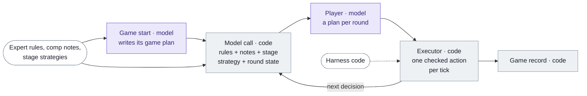
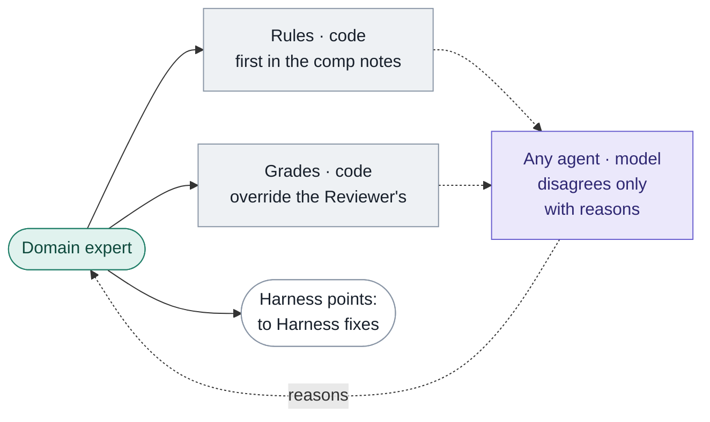
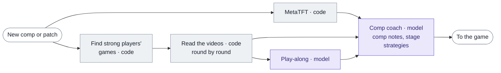
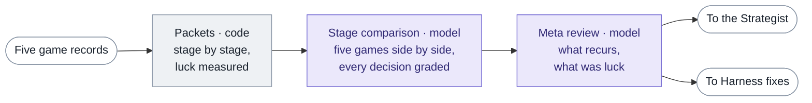
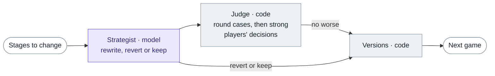
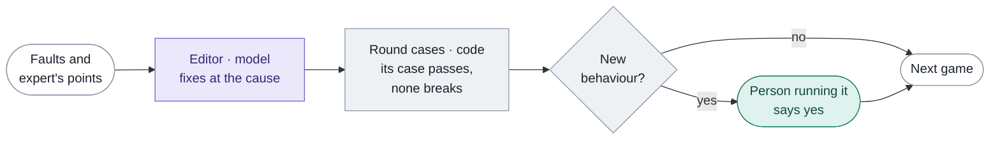

# Architecture

Purple: language model. Grey: code. Green: people. White: hand-over to another part.

## During a game

## Between games

### Expert feedback

### Learn

### Review, every five games

### Strategist

### Harness fixes

